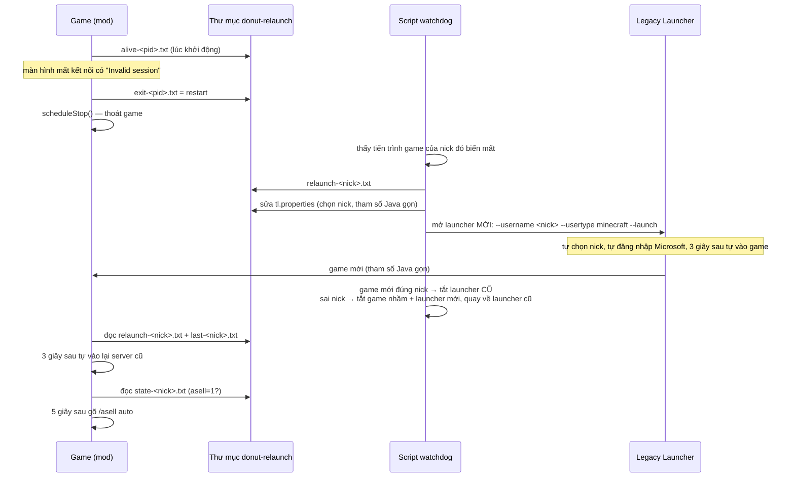

# Donut Relaunch 1.3.1

Treo nhiều nick DonutSMP cùng lúc qua **Legacy Launcher 169.4** (mỗi nick một cửa sổ launcher, chung thư mục game
`%APPDATA%\.tlauncher\legacy\Minecraft\game`) mà không cần ngồi canh:

- game văng vì **"Failed to login: Invalid session"** / "Failed to verify username" hoặc crash → tự mở lại đúng nick, tự vào lại server cũ, tự bật lại **ASell** nếu trước đó đang chạy;
- ASell đứng yên một trạng thái quá lâu → tự `/asell stop` rồi `/asell auto`;
- lúc bạn làm việc khác: game không vẽ thế giới, ưu tiên CPU thấp, RAM trả lại cho Windows.

Đọc tiếp: [CHANGELOG](CHANGELOG.md) · [Hướng dẫn review 1.3.1](docs/REVIEW-1.3.1.md) · [Những gì đã tìm ra về Legacy Launcher](docs/legacy-launcher.md) · [Hướng dẫn cho người dùng](docs/HUONG-DAN.txt)

## Vì sao cần

Mã đăng nhập Minecraft hết hạn khoảng 24 giờ sau khi launcher cấp. Launcher chỉ làm mới mã lúc bấm "Enter the game".
Game chạy lâu rồi vào lại server (sau khi server restart, sau khi ASell tự reconnect…) sẽ bị "Invalid session" và
phải tắt game, bấm lại Enter the game, vào server, gõ lại `/asell auto` — với 4 nick treo đêm là việc không làm tay được.

## Thành phần

| Phần | File | Chạy ở đâu |
|---|---|---|
| Mod Fabric (client, 1.21.4) | [`mod/src/main/java/com/donutrelaunch/`](mod/src/main/java/com/donutrelaunch/) — `RelaunchMod`, `AsellBridge`, `Eco` | trong mỗi game |
| Script watchdog | [`script/donut-relaunch.ps1`](script/donut-relaunch.ps1) | PowerShell chạy ẩn, 1 bản cho cả máy |
| Bộ cài | [`script/Cai dat Donut Relaunch.vbs`](script/) | chạy 1 lần: chép script + file tự chạy vào Startup |
| Jar build sẵn | [`release/donut-relaunch-fabric-1.21.4-1.3.1.jar`](release/) | thư mục `mods` |

Mod và script **không nói chuyện trực tiếp**: chúng trao đổi qua các file nhỏ trong `...\Minecraft\game\donut-relaunch\`.

## Luồng mở lại game

Đo thật ngày 11/10: từ lúc mở launcher mới tới lúc có game 12–16 giây; từ lúc game cũ tắt tới lúc ASell chạy lại khoảng 40 giây.

Nếu `launcher.txt` đặt `mode=click` (hoặc nick nằm trong `launcher-block.txt`), script làm theo cách cũ: bấm nút
"Enter the game" trên cửa sổ launcher cũ — xem mục rủi ro trong [REVIEW](docs/REVIEW-1.3.1.md).

## Mod làm gì

**RelaunchMod**
- Màn hình mất kết nối: gom mọi dòng chữ (đọc các trường `Text` bằng reflection để không phụ thuộc tên trường). Có "invalid session" / "failed to verify username" → ghi `exit-<pid>.txt = restart` rồi `scheduleStop()`.
- Bạn tự tắt game → `exit-<pid>.txt = user` (script không mở lại). Crash → không có file → script coi là crash và mở lại.
- Mỗi lần vào server ghi `last-<nick>.txt`. Ở màn hình chính mà có `relaunch-<nick>.txt` mới (< 30 phút) → 3 giây sau tự vào server đó; bị từ chối thì thử lại sau 30 giây, 60 giây… tối đa 5 phút.
- Ghi `state-<nick>.txt` (`asell=1/0`) mỗi khi ASell đổi trạng thái lúc đang ở trong server. Vào lại sau khi mở game mà `asell=1` → `/asell auto`.
- Canh kẹt (`asell-watch.txt`): ASell báo đang chạy mà trạng thái không đổi quá `stuckMinutes` (3) → `/asell stop`, 3 giây sau `/asell auto`. Bỏ qua lúc server restart/bảo trì, lúc ASell tự dò GUI, lúc ASell khoá an toàn tiền (trừ khi `quarantineMinutes` > 0). Kẹt lần thứ 4 trong 30 phút → thoát game cho script mở lại.
- File lệnh `cmd-<nick>.txt`: `restart` (thoát để script mở lại — dùng khi thay mod), `asell-restart`. Lệnh thử: `/relaunchtest`.

**AsellBridge** — lấy entrypoint của mod ASell (id `donutsell`) qua Fabric Loader → trường `taskManager` → `isRunning()`, trường `state` (enum) và các cờ boolean (chấp nhận tên mixin dạng `asell123$tên`). Không có ASell thì trả `null`, mod bỏ qua phần ASell.

**Eco** (chỉ khi cửa sổ game không được chọn và đang ở trong world)
- `MinecraftClient.skipGameRender = true` mỗi tick: không vẽ thế giới; cửa sổ giữ khung hình cũ, 5 giây vẽ lại 1 khung. Logic game, mạng, ASell vẫn chạy đủ 20 tick/giây.
- Mỗi 10 phút dọn RAM bằng lệnh chẩn đoán `GC.run` (chạy được cả khi JVM có `-XX:+DisableExplicitGC`) và đặt `MaxHeapFreeRatio=30` để G1 trả heap thừa. Bỏ qua khi heap đang giữ đã sát `-Xms`.
- `perf-<nick>.log` mỗi 10 phút: CPU tiến trình, heap, GC, 6 luồng ăn CPU nhất, commit của tiến trình, RAM cả máy.
- Lúc khởi động: nếu `config/modmenu.json` còn `"update_checker": true` → đổi thành `false` (lý do trong CHANGELOG 1.3.1). Luồng `Read-Poller`/`Write-Poller` ăn ≥ 4% CPU 2 lần đo liền → ghi CẢNH BÁO vào `relaunch.log`.

## Script làm gì (mỗi 3 giây)

- Tìm game: `javaw.exe` có `--username` và đúng thư mục game → tên nick + pid launcher cha. **Dòng lệnh của game có access token nên không bao giờ ghi ra log.**
- Game mới: hạ ưu tiên CPU (`priority.txt`, mặc định BelowNormal; launcher giữ Normal), 90 giây sau và mỗi 30 phút gọi `EmptyWorkingSet` cho launcher đang ẩn.
- Game tắt: đọc `exit-<pid>.txt` → `user` thì thôi; `restart`/crash thì tạo việc mở lại. Mở lại liên tục mà vẫn hỏng → chờ 1, 2, 5, 10, 15 phút (15 phút/lần, không bỏ).
- Mỗi lúc chỉ xử lý 1 việc mở lại. `pause.txt` = 1 → vẫn theo dõi nhưng chưa mở lại.
- `usage.log` mỗi 10 phút: CPU, RAM (working set), commit của từng game và launcher, RAM cả máy — giống cột Task Manager.
- File script đổi → tự chạy lại bản mới; việc đang chờ ghi vào `pending-jobs.txt` để bản mới làm tiếp.

## File trong `...\Minecraft\game\donut-relaunch\`

| File | Ai ghi | Nội dung |
|---|---|---|
| `alive-<pid>.txt` | mod | tiến trình này có mod → tắt mà không có exit = crash |
| `exit-<pid>.txt` | mod | `restart` / `user`, nick, lý do |
| `relaunch-<nick>.txt` | script | vừa mở lại → mod tự vào server |
| `last-<nick>.txt` | mod | server cuối cùng của nick |
| `state-<nick>.txt` | mod | `asell=1` / `asell=0` |
| `cmd-<nick>.txt` | bạn | `restart` / `asell-restart` (mod đọc rồi xoá) |
| `pending-jobs.txt` | script | việc mở lại dở dang khi script tự cập nhật |
| `asell-watch.txt`, `eco.txt` | bạn (mod tạo mẫu) | cấu hình mod, đọc lại mỗi phút — mẫu ở [`config-mau/`](config-mau/) |
| `launcher.txt`, `priority.txt`, `pause.txt`, `launcher-block.txt` | bạn (script tạo mẫu) | cấu hình script |
| `relaunch.log`, `perf-<nick>.log` | mod | nhật ký |
| `watchdog.log`, `usage.log` | script | nhật ký |
| `backup\` | script | `tl.properties.bak`, `modmenu.json`, `options.txt`, `sodium-options.json` bản gốc |

## Cài đặt

1. Chép jar vào `...\Minecraft\game\mods\` (chỉ để **một** jar có id `donutrelaunch`; trên máy đang dùng tên cũ `donut-relaunch-fabric-1.21.4-1.0.0.jar` để ghi đè đúng file).
2. Chạy `script\Cai dat Donut Relaunch.vbs` một lần.
3. Mở các nick như bình thường. Client mở từ trước khi có mod: tắt và mở lại 1 lần.

Cần: Fabric Loader ≥ 0.15, Fabric API, Minecraft 1.21.4, Java 21. ASell không bắt buộc.

## Build

- **Gradle (Fabric Loom)**: `cd mod && gradle build` (yarn `1.21.4+build.8`, fabric-api `0.119.4+1.21.4`). Chưa chạy thử được — môi trường build không tải được Loom.
- **Không cần Gradle** (cách đã ra jar trong `release/`): [`tools/build-rl.sh`](tools/build-rl.sh). Chạy lại từ mã nguồn trong repo cho ra jar giống hệt nội dung jar đã phát hành; kiểm tra liên kết với `client-intermediary.jar`: 0 lỗi.

## An toàn

- Không ghi dòng lệnh của game (có access token). Dòng lệnh của **launcher** thì đọc để mở lại launcher, cũng không ghi ra log; trước khi ghi bất cứ dòng lệnh nào ra log, script lọc bỏ nếu có chữ `token`/`session`/`--uuid`.
- Không đọc `.tlauncher\logs\launcher.log` — launcher ghi mã đăng nhập Microsoft dạng chữ thường trong đó. Đừng gửi file này cho ai.
- Script không xoá file nào của bạn; chỉ tắt tiến trình launcher/game do chính nó quản lý (launcher cũ sau khi launcher mới vào đúng nick, game mở nhầm nick).
